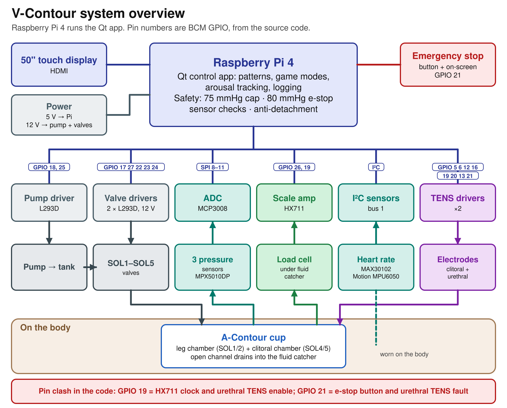
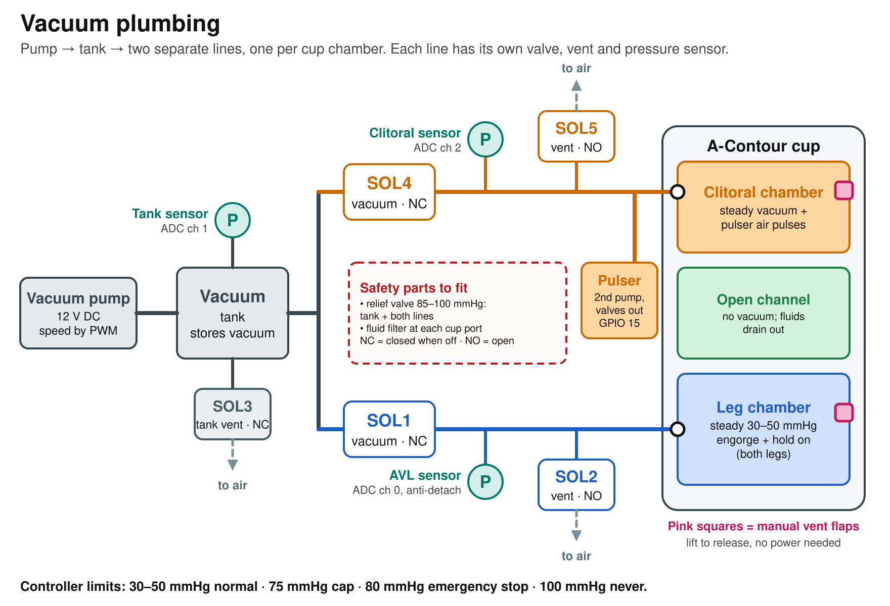
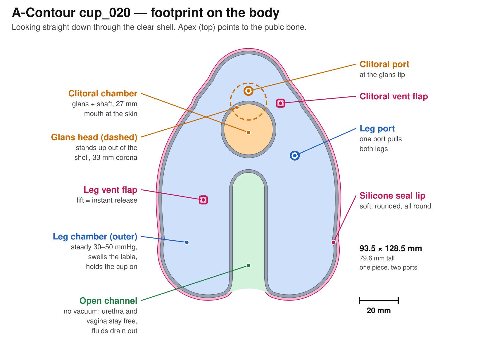
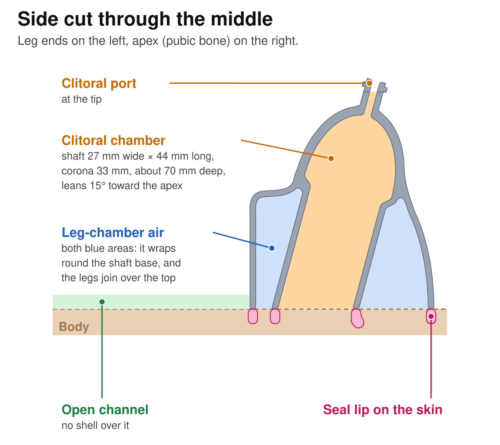
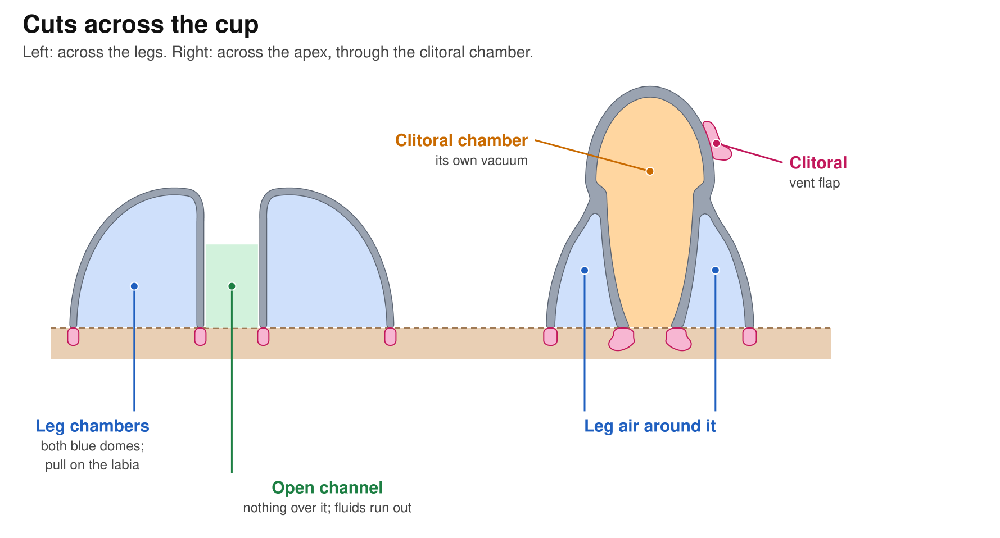

# System Drawings

Pictures of the whole V-Contour system and the A-Contour cup (cup_020).
The cup pictures are sliced from the real cup_020 model, so the shapes and sizes are true.
To redraw them, run the scripts in [`images/make_diagrams/`](images/make_diagrams/).

## 1. Whole system



The Raspberry Pi runs the Qt app and talks to everything through its pins: two kinds of drivers (pump, valves),
an ADC for the three pressure sensors, a scale amp for the fluid catcher, I²C body sensors and two TENS drivers.

> **Pin clash found in the code:** GPIO 19 is both the HX711 clock and the urethral TENS enable, and GPIO 21 is both
> the emergency-stop button and the urethral TENS fault input. These need different pins before both features are wired.

## 2. Vacuum plumbing



One pump fills a vacuum tank. From the tank, two separate lines go to the cup — one for the clitoral chamber
(SOL4 vacuum, SOL5 vent) and one for the leg chamber (SOL1 vacuum, SOL2 vent). Each line has its own pressure sensor.
SOL3 vents the tank.

## 3. The cup from above



## 4. Side cut through the middle



## 5. Cuts across the cup



<details>
<summary>Old ASCII drawing (kept for reference)</summary>

```
┌─────────────────────────────────────────────────────────────────────────────┐
│                    DUAL-CHAMBER VACUUM SYSTEM                               │
│                                                                             │
│   ┌─────────┐    ┌─────────┐                                                │
│   │ DC Pump │───►│  TANK   │◄─── Sensor 2 (Tank)                            │
│   │ (PWM)   │    │         │                                                │
│   └─────────┘    └────┬────┘                                                │
│                       │                                                     │
│              ┌────────┴────────┐                                            │
│              │                 │                                            │
│          [SOL3]            ┌───┴───┐                                        │
│          Tank              │       │                                        │
│          Vent          [SOL1]   [SOL4]                                      │
│              ▼         Outer    Clitoral                                    │
│          ┌─────┐           │       │                                        │
│          │ ATM │           ▼       ▼                                        │
│          └─────┘   ┌───────────────────────┐                                │
│                    │     V-CONTOUR CUP     │                                │
│                    │   OUTER V-CHAMBER   ◄─┼─── Sensor 1 (AVL)              │
│                    │                       │                                │
│                    │      ┌─────────┐      │                                │
│                    │      │CLITORAL │◄─────┼─── Sensor 3 (Clitoral)         │
│                    │      │CYLINDER │◄─────┼───┐                            │
│                    │      └┬───────┬┘      │   │                            │
│                    │       │ OPEN  │       │  [SOL5]                        │
│                    │       │CHANNEL│       │  Clitoral                      │
│                    │       │  FOR  │       │  Vent                          │
│                    │       │ DRAIN │       │     │                          │
│                    │       │   │   │       │     ▼                          │
│                    │       │   │   │       │  ┌─────┐                       │
│                    │       │   │   │       │  │ ATM │                       │
│                    │       │   │   │       │  └─────┘                       │
│                    │       │   ▼   │       │                                │
│                    └───────┘       └───────┘                                │
│                        ▲                                                    │
│                        │   ┌─────┐                                          │
│                    [SOL2]──│ ATM │───►                                      │
│                    Outer   └─────┘                                          │
│                    Vent                                                     │
└─────────────────────────────────────────────────────────────────────────────┘
```

</details>
