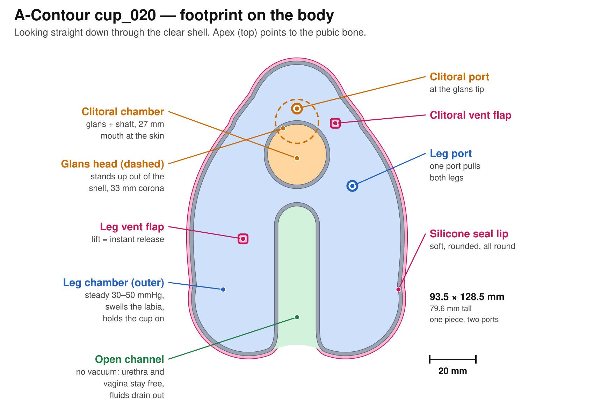
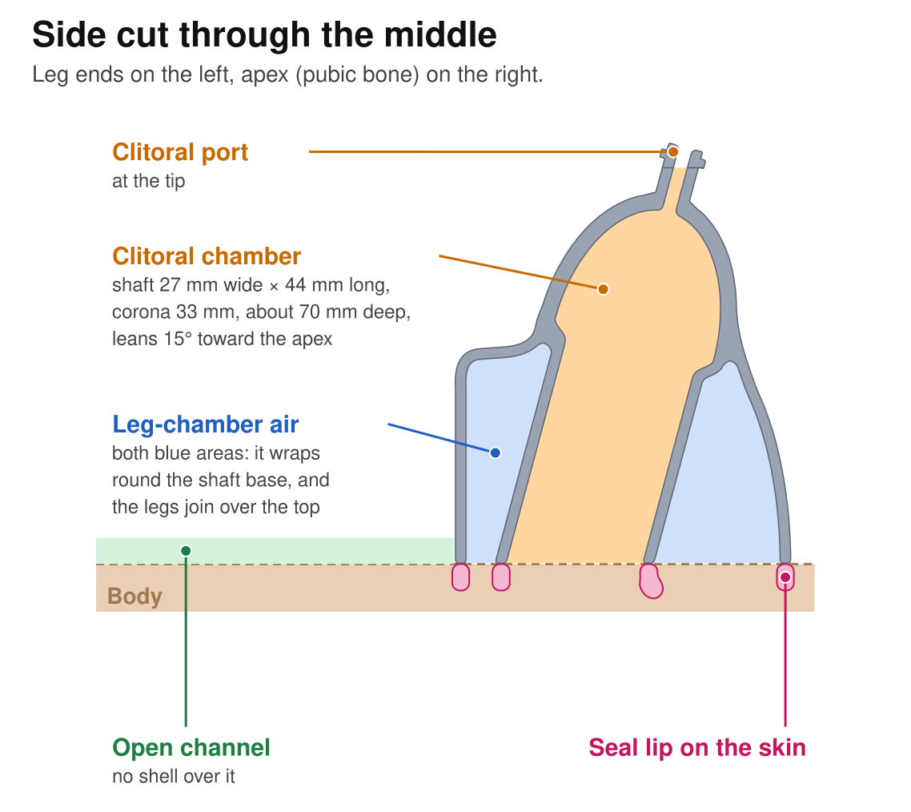
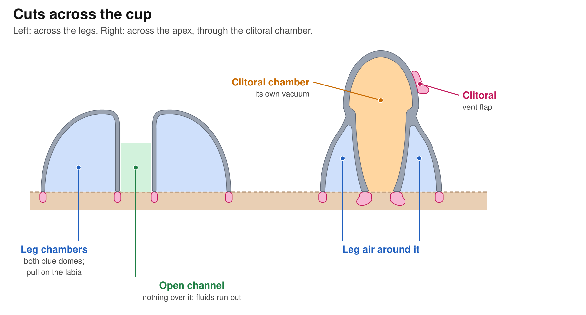
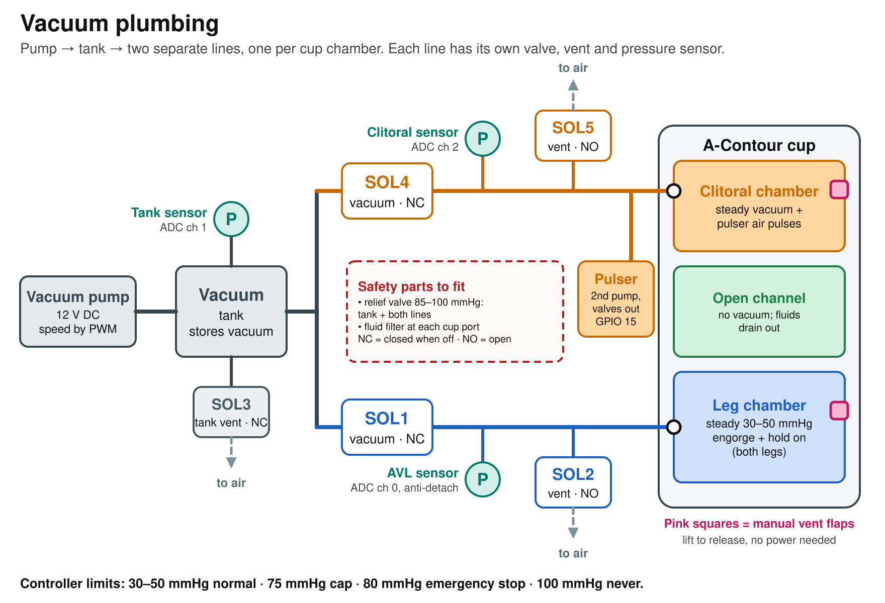

# Vacuum Cup Explanation

*Updated 2026-11-16 for the current design, **cup_020**. Design files: [`hardware/cup/v6/`](../hardware/cup/v6/).
The pictures are sliced from the real cup_020 model.*

## Overview

The vacuum cup is called the **A-Contour**. It is purpose-built for vulva anatomy and has **two separate vacuum chambers** plus an **open channel**, so it can do what dome cups and air-pulse toys can't: hold steady vacuum to engorge the vulva and clitoris, and pulse the clitoris, at the same time and independently.

It is **one piece** (clear Tritan shell, silicone seal lip and vent flaps molded on) with **two ports**.

## Problems with Traditional Dome Cups

- Generic dome shape doesn't match vulva anatomy
- Single chamber cannot provide both attachment AND targeted stimulation
- Closed design traps fluids (urine, vaginal secretions, ejaculate) inside
- No access to urethra or vaginal opening for simultaneous play
- Uniform suction cannot replicate localized oral stimulation sensations

## The A-Contour Solution: Two Chambers + Open Channel

### Leg Chamber (outer, blue)
- **Where**: the two legs of the "A", which join over the top of the clitoral chamber
- **Function**: holds the cup on (anti-detachment) + steady vacuum that engorges the labia
- **Pressure**: 30–50 mmHg (4–6.7 kPa) steady – never above the controller's 75 mmHg cap
- **Valves**: SOL1 (vacuum) / SOL2 (vent); **AVL sensor** on this line, ADC channel 0
- **Port**: one leg port on top of the right leg pulls both legs
- **Manual vent**: silicone flap on top of the left leg

### Clitoral Chamber (inner, orange)
- **Shape**: a glans + shaft. Shaft **27 mm wide × 44 mm long**, corona **33 mm**, head 26 mm – about **70 mm (2.75") deep**, 34.3 cm³. The head and corona stand up out through the shell.
- **Lean**: 15° toward the pubic bone
- **Hood retractor ridge**: soft 1.5 mm silicone ridge on the apex side of the mouth holds the hood back from above (nothing goes under the hood)
- **Pressure**: 0–75 mmHg (0–10 kPa) – controller hard cap 75 mmHg
- **Valves**: SOL4 (vacuum) / SOL5 (vent); clitoral sensor on this line, ADC channel 2
- **Two modes**:
  - **Steady vacuum** – engorges the clitoris
  - **Air pulses** – rapid oscillation (5–13 Hz) for stimulation
- **Port**: at the glans tip
- **Manual vent**: silicone flap on the side of the glans head

### Open Channel (green)
- **Where**: between the legs, with no plastic over it
- **Function**: no vacuum here – the urethra and vaginal opening stay out of the suction, fluids drain out, and an insertable toy can be used

## Physical Specifications (cup_020)

| Parameter | Value | Notes |
|-----------|-------|-------|
| Overall size | 93.5 × 128.5 × 79.6 mm | width × length × height |
| Shell wall | 2.0 mm | |
| Leg chamber | 204.1 cm³ | legs connected |
| Clitoral chamber | 34.3 cm³ | ~70 mm deep |
| Ports | 2 | Luer |
| Manual vents | 2 silicone flaps | no power needed |
| Pressure rating | Max 100 mmHg (13.3 kPa) – controller hard cap 75 mmHg; shell bench-tested empty to 200 mmHg, never on skin | Deep vacuum damages tissue |

## Materials

- **Shell**: Clear Tritan copolyester – see-through for placement
- **Seal lip, hood ridge, vent flaps**: Platinum-cure silicone, molded onto the shell
- **Compliance targets**: ISO 10993 biocompatible materials, ISO 80369-7 Luer connections

## Port Configuration

- **Leg port**: SOL1 / SOL2 line. The AVL pressure sensor tees into this tube **at the controller** – there is no separate sensor tap on the cup.
- **Clitoral port**: SOL4 / SOL5 line, with the clitoral pressure sensor teed in at the controller.

## Key Differentiator: Active Engorgement

Unlike commercial air-pulse toys (Womanizer, Satisfyer, LELO) that only provide oscillating pressure waves, the A-Contour can create **sustained vacuum for tissue engorgement**. This allows:

1. **Faster arousal**: Engorge the clitoris BEFORE beginning stimulation
2. **Maintained engorgement**: Sustained leg-chamber vacuum keeps tissue engorged throughout
3. **Faster orgasm**: Optimal clitoral erection from the start
4. **Enhanced sensitivity**: Engorged tissue exposes more of its ~8,000 nerve endings
5. **Consistent response**: Does not rely on the user's natural arousal state

## Open-Channel Benefits

1. **Vaginal access**: insertable toys can be used while vacuum is active
2. **Urethral access**: sounding or catheter play is possible during vacuum
3. **Hygiene / drainage**: lubrication, urine and squirting exit through the channel instead of the vacuum lines
4. **Easy cleanup**: hoses stay dry

## Anti-Detachment System

The AVL sensor monitors the leg-chamber pressure. If pressure rises above an adjustable threshold (the cup is starting to come loose), the system opens SOL1 to pull more vacuum – never above the 75 mmHg cap.

## Safety

- **Undercut**: the corona (33 mm) is wider than the shaft (27 mm). Before removing, vent **both** chambers (lift the flaps), wait for the swelling to go down, never pull off under vacuum.
- **Deep chamber**: how far tissue is drawn in depends on vacuum and time – start low and short.
- See [cup cleaning & entrapment safety](cup-cleaning-and-entrapment-safety.md) and [clitoral chamber sizing research](clitoral-chamber-sizing-research.md).

## Related Files

- `hardware/cup/v6/` – cup_020 STL meshes, Blender scene, parameters, build scripts, renders
- `hardware/cup/v6/scripts/cup_sdf.py` – the model that generates the cup
- `docs/images/make_diagrams/` – scripts that draw the pictures in these docs
