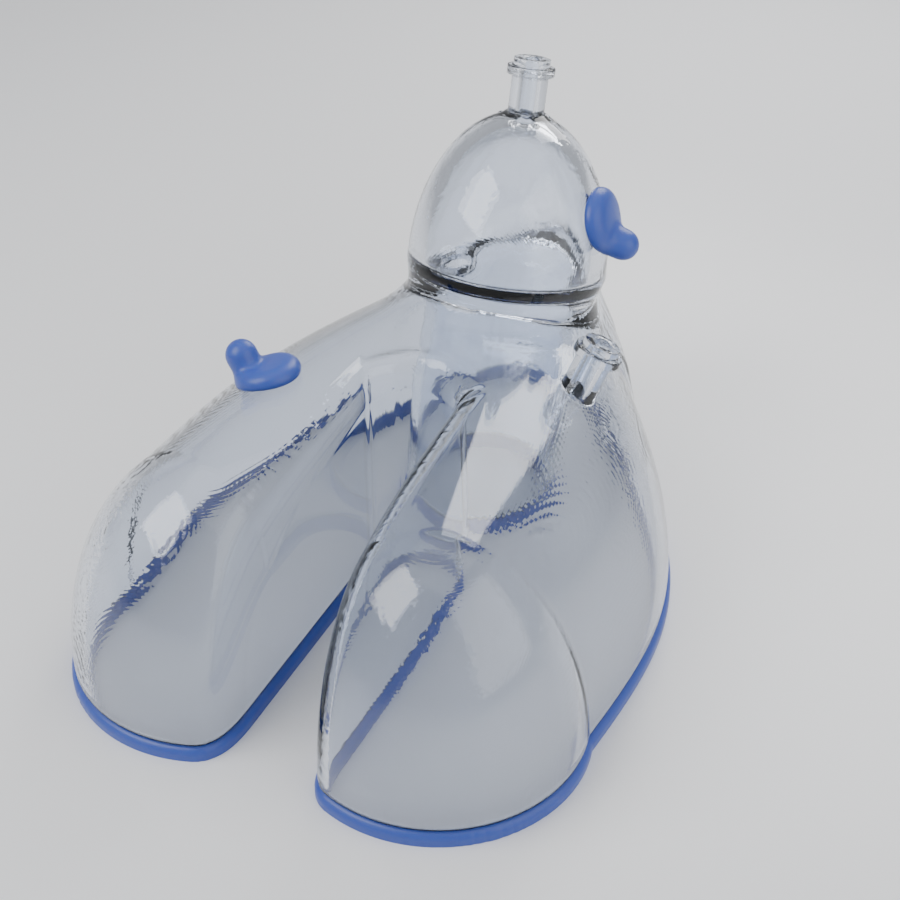
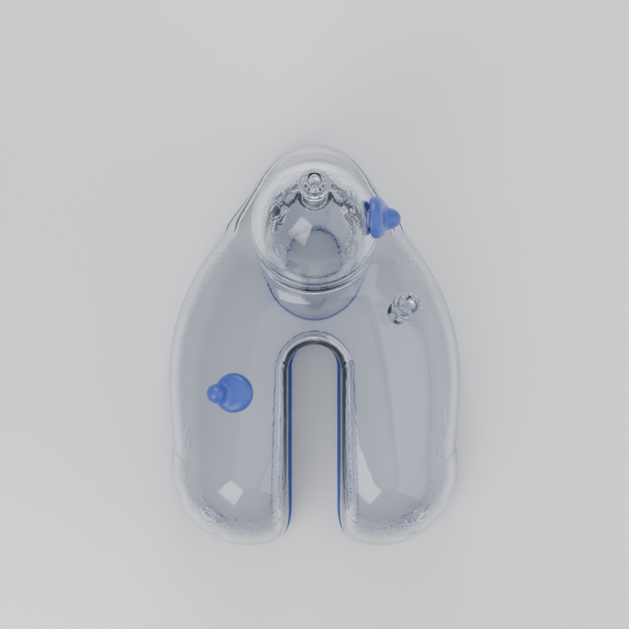
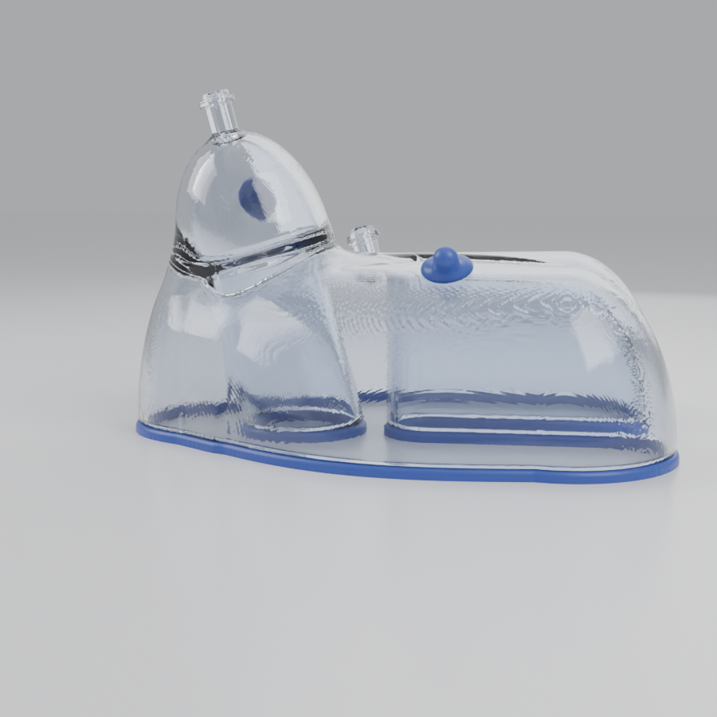
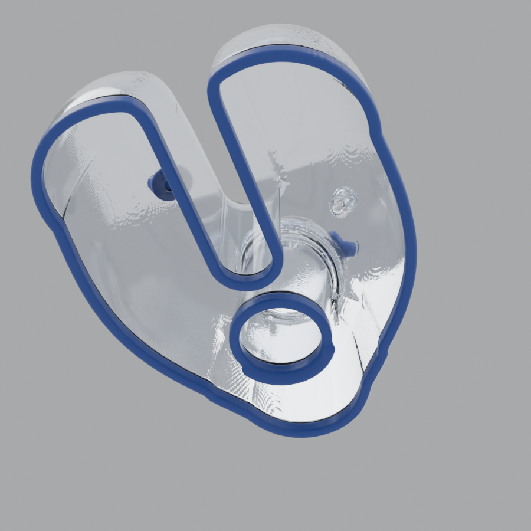
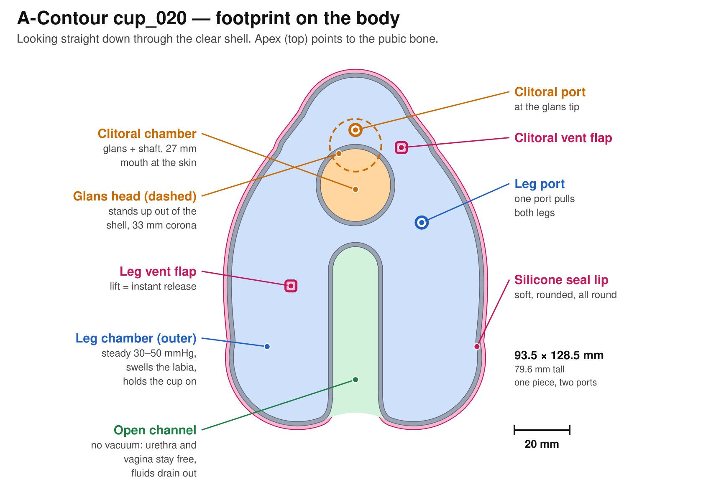
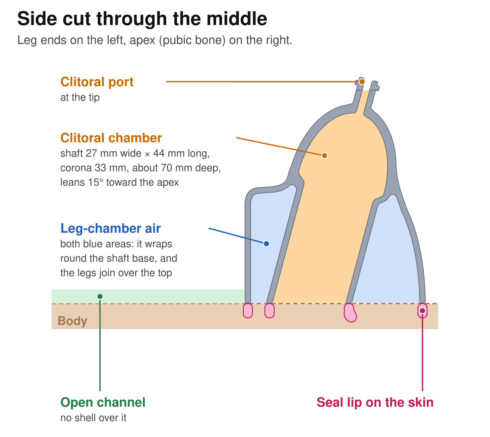
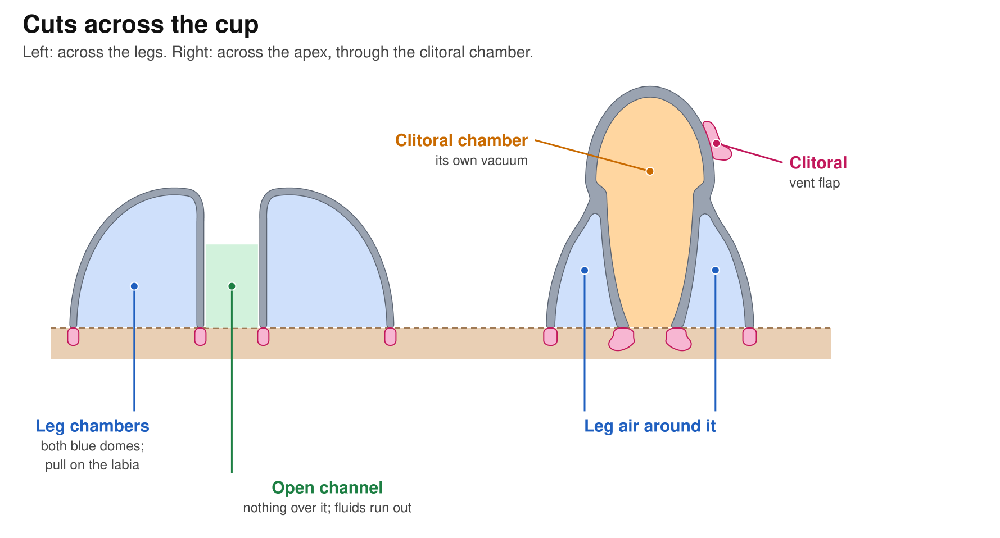

# A-Contour Cup — v6 (design cup_020)

The updated A-Contour dual-chamber cup. The original cup files in `hardware/cup/` are kept as they were.



| Top | Side | Underside |
|---|---|---|
|  |  |  |

## Labelled drawings

Sliced from this folder's `shell.stl` and `seal.stl`. Blue = leg chamber, orange = clitoral chamber, green = open channel, pink = silicone.







How it connects to the controller: [vacuum plumbing](../../../docs/images/vacuum-plumbing.svg) · [system overview](../../../docs/images/system-overview.svg)

## What changed

- **Glans + shaft clitoral chamber** in place of the older teardrop/nose chamber.
- **Longer shaft (44 mm)**, so the glans head and corona stand up out through the shell.
- **Hood retractor ridge**: a soft 1.5 mm silicone ridge under the lip (120° arc on the apex side). It holds the hood back from above. Nothing goes under the hood.
- **Clitoral port** at the glans tip, sleeved through the leg chamber's air.
- **Clitoral vent flap** on the side of the glans head.
- **Open channel between the legs**, so fluids drain out.
- **One piece, two ports.**

## Numbers

| | |
|---|---|
| Overall size | 93.5 × 128.5 × 79.6 mm |
| Clitoral chamber | shaft 27 mm wide × 44 mm, corona 33 mm, head 26 mm, about 70 mm (2.75") deep, 34.3 cm³ |
| Leg (outer) chamber | 204.1 cm³, legs connected |
| Chambers | separate, watertight |
| Glans | leans 15° toward the apex, moved 4 mm toward the apex |
| Shell wall | 2.0 mm, divider 2.0 mm |
| Skin-safety check | **PASS**: 0 sharp and 0 thin points on the skin side (worst angle 61.3° shell, 63.8° silicone; limit 70°) |

## Safety notes

- **The corona is wider than the shaft (an undercut).** Before removing the cup, vent **both** chambers (lift the flap knobs) and wait for the swelling to go down. Never pull the cup off while it is under vacuum.
- **Deep tube.** How far the clitoris is drawn in depends on vacuum and time. Start with low vacuum and short sessions, especially where the tissue is thinner, for example after menopause. The controller caps vacuum at 75 mmHg.

## Files

| File | What it is |
|---|---|
| `shell.stl` | Clear PC/Tritan shell (hollow wall, ports bored) |
| `seal.stl` | Silicone seal lip under the rims |
| `cup_020.blend` | Blender scene with the "Cup" designer sidebar |
| `params.json` | Exact parameters for this design |
| `stats.json` | Size, volumes and watertight flags from the build |
| `skin_safety_check.json` | Sharp-edge and thin-wall check results |
| `scripts/cup_sdf.py` | Signed-distance-field model that builds the watertight meshes |
| `scripts/acontour_cup.py` | Blender add-on: sliders that rebuild the cup (3D View > Sidebar (N) > Cup) |
| `scripts/build_blend.py`, `open_view.py` | Blender scene helpers |
| `scripts/edge_check.py` | Skin-safety edge check |
| `renders/` | Hero, top, side and underside renders |

Coordinates are in mm: X = width, Y = apex (+) to leg ends (−), Z = up. The skin plane is Z = 0.

## Rebuild

Needs Python with `numpy`, `trimesh` and `scikit-image`.

```bash
python scripts/cup_sdf.py OUT_DIR 0.3 params.json
```

`0.3` is the voxel size in mm (final quality). Use `0.8` for a quick preview.
